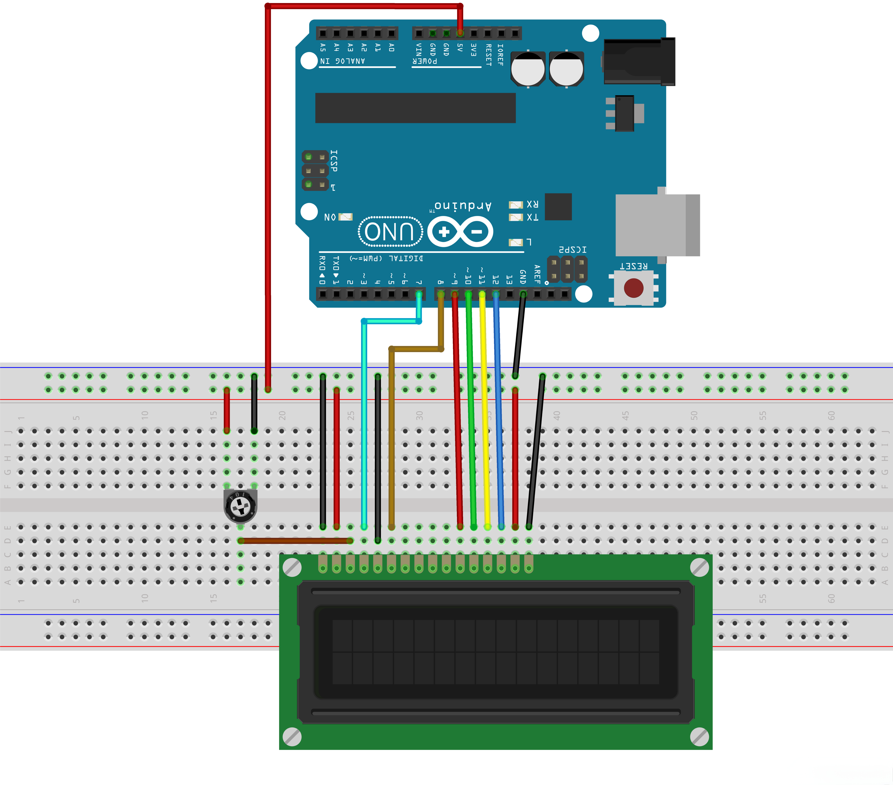

# Component Lab: 16x2 LCD Display

Microcontrollers can use displays to communicate information to users. In this lab, you will connect a 16x2 LCD (Liquid Crystal Display) to your Arduino and display temperature and humidity readings from the DHT11 sensor. The LCD has two rows that can each display 16 characters.

# 1. Build the circuit

You will need the following components:

- Arduino Uno
- DHT11 temperature and humidity sensor
- 16x2 LCD display
- 10kΩ potentiometer
- Breadboard
- Jumper wires

Keep your DHT11 connected from the previous lab.

| DHT11 Pin | Arduino Pin |
|---|---|
| VCC (+) | 5V |
| Data / Out | Digital Pin 7 |
| GND (-) | GND |

Connect the LCD using the following pins:

| LCD Pin | Connection | Name | Purpose |
|---|---|---|---|
| 1 | GND | VSS | Ground |
| 2 | 5V | VDD | Power |
| 3 | Potentiometer middle pin | VO | Adjusts contrast |
| 4 | Digital Pin 6 | RS | Selects commands or data |
| 5 | GND | RW | Sets write mode |
| 6 | Digital Pin 7 | E | Enables data transfer |
| 7–10 | Not connected | D0–D3 | Unused data pins |
| 11 | Digital Pin 8 | D4 | Data bit 4 |
| 12 | Digital Pin 9 | D5 | Data bit 5 |
| 13 | Digital Pin 10 | D6 | Data bit 6 |
| 14 | Digital Pin 11 | D7 | Data bit 7 |
| 15 | 5V | A | Backlight power |
| 16 | GND | K | Backlight ground |

The LCD uses 4-bit mode, meaning it sends data through four data pins (D4–D7).

### The potentiometer

A potentiometer is a variable resistor. Turning the knob changes the resistance to adjust the LCD's contrast.

Use the following wiring diagram to guide.

# 2. Install the library

In the Arduino IDE, add the LCD "LiquidCrystal" library. 

Add the following line at the top of your program:

`#include <LiquidCrystal.h>`

The library provides several functions:

| Function | Behavior |
|---|---|
| `lcd.begin(16, 2)` | Initializes a 16-column, 2-row display |
| `lcd.setCursor(column, row)` | Positions the cursor |
| `lcd.print(value)` | Displays text or numbers |
| `lcd.clear()` | Clears the display |

The LCD uses coordinates starting at zero. For example, `lcd.setCursor(0, 1)` positions the cursor at the beginning of the second row.

# 3. Program the Arduino

Use the starter code in `lcd_display.ino` to get started.

## Task 1: Initialize the LCD

The starter code creates an LCD object using

`LiquidCrystal lcd(rs, e, d4, d5, d6, d7);`

Like the DHT11, the LiquidCrystal object cont

Inside `setup()`, initialize the display with `lcd.begin(16, 2)`.

Add a short comment explaining what this statement does.

## Task 2: Test the display

Use `lcd.print()` to display the message `Hello, Apex!` on the first row.

Upload your code and verify that the message appears. Adjust the potentiometer if necessary.

## Task 3: Position text

Use `lcd.setCursor()` to display the following:

- First row: `Temperature`
- Second row: `Humidity`

Remember that the first row is numbered 0 and the second row is numbered 1.

## Task 4: Display sensor measurements

Use the DHT11 functions from the previous lab to read temperature and humidity. Reuse your `celsiusToFahrenheit()` function to convert the temperature.

Modify the program to display:

- Row 1: Temperature in Fahrenheit
- Row 2: Relative humidity as a percentage

Use `lcd.print(value, 1)` to display measurements to one decimal place.

Your display should update every five seconds.

## Task 5: Upload and verify

Upload your code to the Arduino. Verify that both measurements appear on the LCD and update every five seconds.

# 4. Test your display

Test that the LCD correctly displays measurements from the sensor.

### Test 1: Contrast

Turn the potentiometer in both directions. Observe how the display changes.

Observations: the screen would stay on but the text would dim

### Test 2: Temperature

Hold your hand near the DHT11 without touching the electrical connections. Observe the temperature on the LCD.

Observations: 

### Test 3: Humidity

Gently breathe toward the DHT11 from a short distance. Observe the humidity on the LCD.

Observations: it goes up about 20-30 percent

### Results

Summarize your measurements in the table below.

| Test | Temperature (°F) | Humidity (%) | Observations |
|---|---|---|---|
| Baseline | 73.6 | 22.0% | it is the baseline|
| Temperature | 74.3| 23.0%| it did not go up in temp that much|
| Humidity | 75.0| 33.0%| this went up a lot and then started summoning the mother ship|

# 5. Reflection

Answer the following questions.

1. What is the purpose of the `LiquidCrystal` library? Why do we use it?

   > so we dont have to worry about a thousand lines of code

2. What is the difference between `lcd.print()` and `Serial.print()`?

   > serial print, prints to the console and lcd.print prints to the screen

3. Explain what the two numbers mean in `lcd.setCursor(0, 1)`.

   > column then row

4. What does the potentiometer control? What happens when you adjust it?

   > how much power the text receives

5. Why does the LCD require multiple data pins while the DHT11 uses only one?

   > because the lcd needs a lot of info to display the text and the temp sensor is only giving out info not receiving and displaying

6. How could you use the LCD to alert a user when a temperature or humidity measurement exceeds a certain value?

   > print and alert message